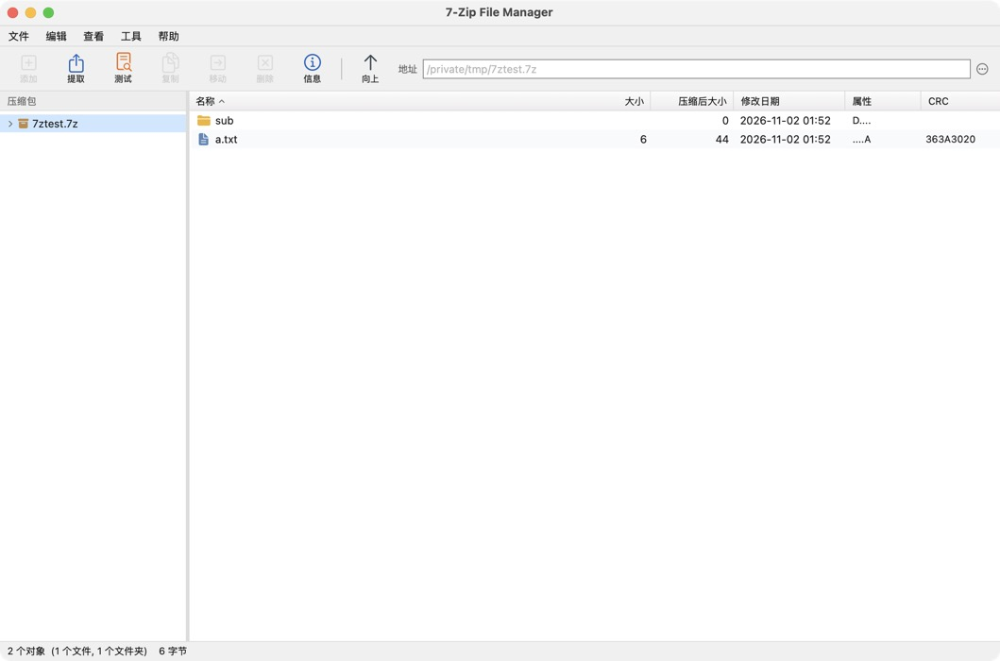

# 7-Zip File Manager for macOS

给 macOS 用的 7-Zip 图形界面 —— 官方 7-Zip 只提供 Windows 图形界面，macOS / Linux 只有命令行 `7zz`。这个 App 把 `7zz` 包进一个原生窗口里，界面照 Windows 版 7-Zip File Manager 的布局复刻：菜单条 + 工具栏 + 左侧目录树 + 右侧文件列表 + 状态栏。



## 特性

- **原生 App**，不需要 Electron / Python / Homebrew，7zz 引擎已内置（通用二进制，Intel + Apple Silicon）
- **Windows 风格界面**：Win32 灰底、方角按钮、凹陷输入框、蓝色选中行、3D 列标头、等宽数字列
- **浏览文件系统** 与 **直接打开压缩包内部**（7z / zip / tar / gz / bz2 / xz / rar / iso / jar 等 30+ 扩展名）
- **添加**：7z / zip / tar / gz / xz / bz2，6 档压缩等级、3 种更新模式、分卷（MB）、密码、7z 加密文件名
- **提取**：全部或选中项，覆盖 / 跳过 / 自动重命名，保留目录结构或平铺，支持密码
- **测试压缩包**、**压缩包信息**、**文件信息**
- **复制 / 移动 / 删除（废纸篓）/ 新建文件夹 / 重命名**
- 双击压缩包内的文件 → 自动解到缓存目录并调用默认程序打开
- 列宽可拖动、点列头排序、多选（⌘ / ⇧ 点击）、拖拽分隔条调整目录树宽度
- 记住上次目录、排序列、列宽、隐藏文件开关

## 安装

### 方式一：下载发行版

到 [Releases](../../releases) 下载 `7-Zip-File-Manager-x.y.z.dmg`，打开后把 **7-Zip File Manager** 拖进 Applications。

发行版是 ad-hoc 签名（未做 Apple 公证），首次打开会被 Gatekeeper 拦一下：

- 右键图标 →「打开」→ 再点「打开」；或
- 系统设置 → 隐私与安全性 → 拉到下面点「仍要打开」；或
- 直接去掉隔离标记：

```bash
xattr -dr com.apple.quarantine "/Applications/7-Zip File Manager.app"
```

### 方式二：从源码构建

需要 macOS 14+ 和 Xcode Command Line Tools（`xcode-select --install`），不需要完整 Xcode 工程。

```bash
./build.sh                            # 生成 "7-Zip File Manager.app"
open "7-Zip File Manager.app"         # 运行
cp -R "7-Zip File Manager.app" /Applications/   # 安装
```

`build.sh` 第一次运行会自动从 7-Zip 官方 release 下载 `7z2605-mac.tar.xz`，校验 SHA256 后解出 `7zz`。想换版本：

```bash
SEVENZIP_VERSION=26.05 SEVENZIP_SHA256=skip ./build.sh
```

常用环境变量：

| 变量 | 默认 | 说明 |
| --- | --- | --- |
| `VERSION` | `1.0.0` | 写入 Info.plist 的版本号 |
| `BUILD_NUMBER` | 时间戳 | 写入 Info.plist 的构建号 |
| `ARCHS` | `arm64 x86_64` | 目标架构，空格分隔 |
| `SIGN_IDENTITY` | `-`（ad-hoc） | 换成 Developer ID 可正常分发 |
| `SEVENZIP_VERSION` | `26.05` | 内置 7zz 版本 |

打包 DMG + ZIP：

```bash
./scripts/package.sh        # 产物在 dist/
```

## 自动发布

仓库带了两个 GitHub Actions 工作流：

| 工作流 | 触发 | 做什么 |
| --- | --- | --- |
| `.github/workflows/build.yml` | push 到 `main`、PR、手动 | 编译 + 打包，产物作为 artifact 保留 14 天 |
| `.github/workflows/release.yml` | **发布 Release**、推 `v*` tag、手动指定 tag | 编译通用二进制 → 打 DMG / ZIP / SHA256 → 上传到该 Release |

发布一个新版本只需要：

```bash
git tag v1.0.0
git push origin v1.0.0
```

或者直接在 GitHub 网页上 **Draft a new release** → 填 tag `v1.0.0` → Publish，工作流会自动把安装包挂上去。版本号取自 tag（去掉前缀 `v`）。

> 想用 Developer ID 正式签名 + 公证，需要在仓库 Secrets 里配证书并在工作流里加 `codesign --options runtime` + `notarytool`，目前默认走 ad-hoc。

## 快捷键

| 快捷键 | 功能 |
| --- | --- |
| ⌘O | 打开压缩包 |
| ⌘N | 添加到压缩包 |
| ⇧⌘N | 新建文件夹 |
| ⌘E | 提取 |
| ⌘T | 测试压缩包 |
| ⌘I | 信息 |
| ⌘R | 刷新 |
| ⌘A | 全选 |
| ⌘⌫ | 删除 |
| ⌘↑ | 上一级 |
| ↑ ↓ | 移动选中项 |
| Return | 打开 |
| Esc | 取消选择 |

## 目录结构

```
Sources/
  main.swift         程序入口、窗口、原生菜单、键盘
  Theme.swift        配色、字号、Win32 风格控件
  Core.swift         7zz 引擎封装、压缩包解析、AppState
  Views.swift        菜单条、工具栏、目录树、文件列表、状态栏
  Dialogs.swift      添加 / 提取 / 信息 / 密码 / 选项 / 关于 / 进度对话框
  ContentView.swift  整体布局与弹层
tools/make_icon.swift  程序化生成 AppIcon.icns
scripts/package.sh     打 DMG / ZIP / SHA256
build.sh               一键构建（自动下载并校验 7zz）
LICENSES/              第三方许可证原文
.github/workflows/     CI 与自动发布
```

## 已知限制

- 不能直接删除 / 重命名压缩包**内部**的条目（7-Zip 需要重建整个包，v1 未实现）
- 在压缩包视图里不能"添加文件到当前压缩包"，需要在文件系统中选中文件再「添加」
- 不支持在窗口内拖放文件（下一步再加）
- 加密压缩包打开时若密码错误会再次弹出密码框，没有次数限制
- 单文件压缩（gz/xz/bz2）只支持单个文件

## 许可

本项目自身的源码（Swift、脚本、图标生成器）采用 **MIT**，见 [LICENSE](LICENSE)。

App 内置的 7-Zip 命令行 `7zz` **未做任何修改**，仍归 Igor Pavlov 所有，按
**GNU LGPL 2.1 或更高版本**分发（部分代码含 unRAR 限制、BSD 3-clause、BSD 2-clause）。
注意是 **LGPL** 不是 GPL。完整说明见 [THIRD-PARTY-NOTICES.md](THIRD-PARTY-NOTICES.md)，
许可证原文见 [LICENSES/](LICENSES/)，并随 App 包内 `Contents/Resources/` 一起分发。

7-Zip 上游：<https://github.com/ip7z/7zip> · <https://www.7-zip.org>

界面：WorkBuddy × likeweixue
